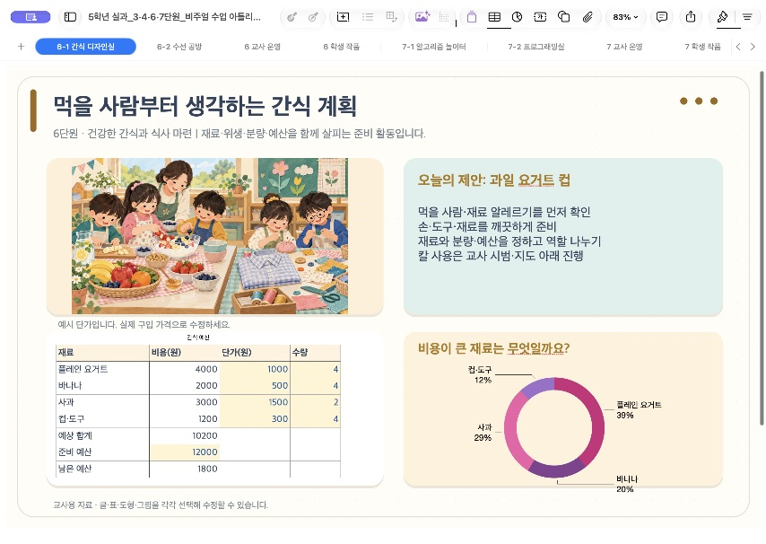
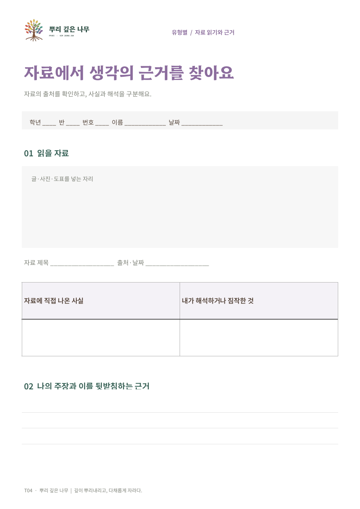

# Apple Edu MCP · 교사의 iWork 제작 도우미

**“애플 MCP로 예쁘고 편집 가능한 수업 자료를 만들어 줘.”**

Mac의 Numbers·Keynote·Pages를 AI와 연결합니다. 글·표·그림·도형·수식으로 원본을 만들고 후속 요청으로 별도 수정본을 저장합니다. 유료 Apple 개발자 가입은 필요하지 않습니다. Apple 앱과 AI 서비스의 이용 조건·비용은 별개입니다. Apple의 공식 제품은 아닙니다.

[교사용 설치 안내](docs/INSTALL.md) · [설치 도우미 다운로드](https://github.com/Kimmahone/apple-edu-mcp/releases/latest/download/Apple-MCP-Installer.zip) · [예시와 원본 다운로드](examples/README.md) · [지원 범위](docs/SUPPORT.md) · [업데이트](docs/UPDATES.md)

| Numbers 수업 도화지 | Keynote 수업 자료 | Pages 학습지 |
|---|---|---|
|  |  |  |

## 이렇게 요청하세요

> 5학년 시간과 용돈 관리 수업 자료를 Numbers로 만들어 줘. 따뜻한 색의 그림, 시간 그래프, 직접 고칠 수 있는 용돈 표와 수식을 넣어 줘. 교사용 안내와 학생 결과물을 나중에 넣을 자리도 마련해 줘.

> 제목을 바꾸고 용돈을 1만 원으로 고쳐 줘. 원본은 남기고 새 수정본으로 저장해 줘.

AI가 자연어를 MCP의 제작 규격으로 바꿉니다. JSON이나 도구 이름을 외울 필요는 없습니다. 사용할 이미지 파일은 승인 작업공간의 Input에 준비합니다. 이미지 생성·인터넷 검색은 연결한 AI의 별도 기능이며 이 MCP 자체 기능은 아닙니다.

## 처음 사용하기

1. Mac에 iWork와 [Node.js 24 이상](https://nodejs.org/ko/download)을 준비합니다.
2. 설치 도우미 ZIP의 압축을 풀고 **설치하기.command**를 실행합니다.
3. 생성된 **AppleMCP/설정_안내.md**를 따라 AI 앱에 한 번 연결합니다. 기존 항목이 있으면 중복 추가하지 않습니다.
4. “애플 MCP로 현재 버전과 사용할 수 있는 기능을 확인해 줘”라고 요청합니다.

도우미는 기존 MCP 설정을 수정하지 않습니다. 다음 업데이트는 **업데이트하기.command**, 복구는 **이전 버전으로.command**로 실행합니다. 끝나면 AI 앱에서 MCP 연결을 다시 시작합니다.

## 현재 범위

공개 배포판 **1.1.0**입니다. iWork 제작·수정·저장·재열기·반복 요청 방지를 현재 개발 Mac에서 검증합니다. 다른 Mac·교사·iPad 실기는 아직 완료하지 않았습니다. 모든 iWork 기능을 자동화한다는 의미는 아닙니다. 외부 템플릿 편집은 일부 글·셀·그림·위치 수정으로 제한됩니다. 예시의 완성도에는 공개 앱 API와 화면 검수도 포함됩니다. Freeform·Pixelmator·Final Cut·Logic 도구는 후속 실험 범위입니다. [자세한 지원 한계](docs/SUPPORT.md)

## 개발과 배포

```sh
npm ci
npm run typecheck
npm test
npm run test:distribution
npm run build
npm run test:mcp
npm run release:check
```

GitHub Actions는 코드·업데이트·새 MCP 연결·공개 파일을 검사합니다. 실제 Mac 앱 검증은 별도 가상 자료로 실행하고 결과와 코드 지문이 일치해야 배포합니다. [관리자 배포 절차](docs/MAINTAINING.md)

코드는 [MIT](LICENSE), 라이브러리는 [별도 라이선스](THIRD_PARTY_NOTICES.md), 예시와 브랜드는 [예시 이용 안내](examples/USAGE.md)를 따릅니다.
