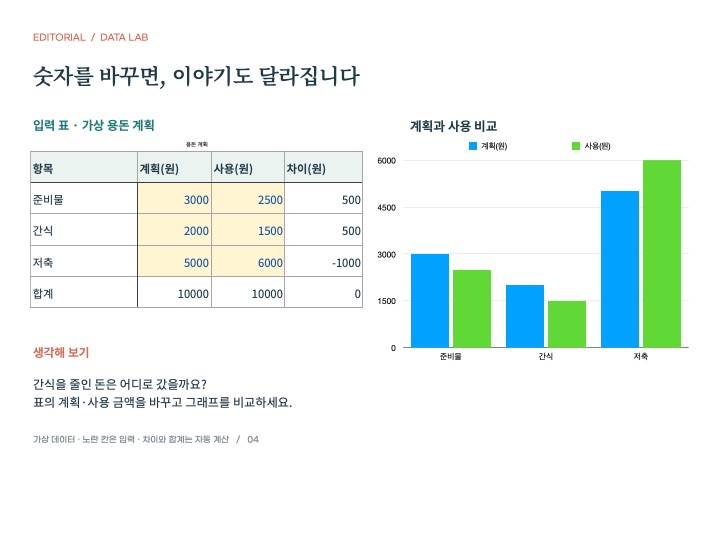
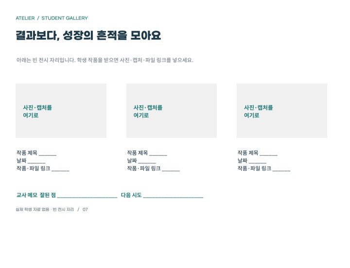
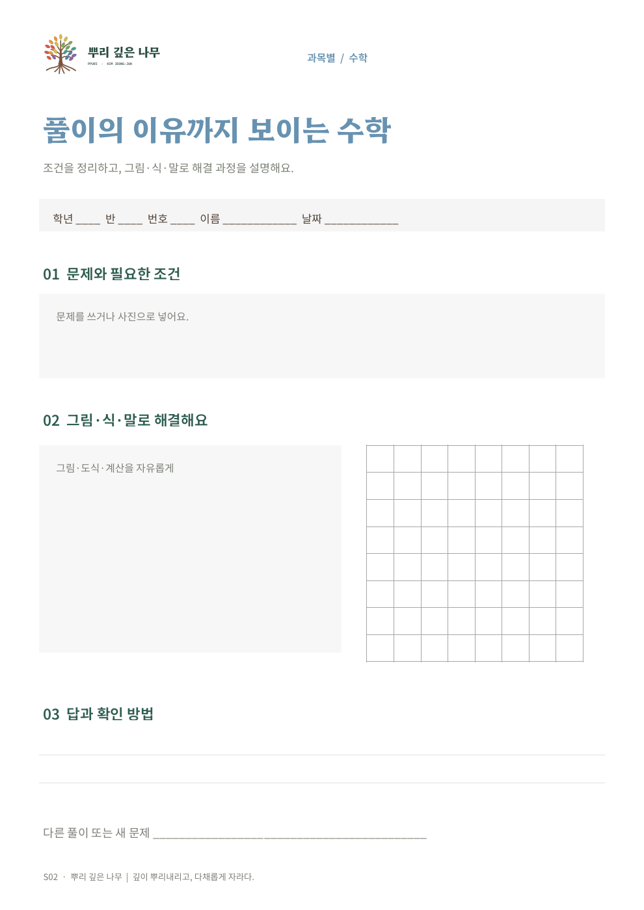
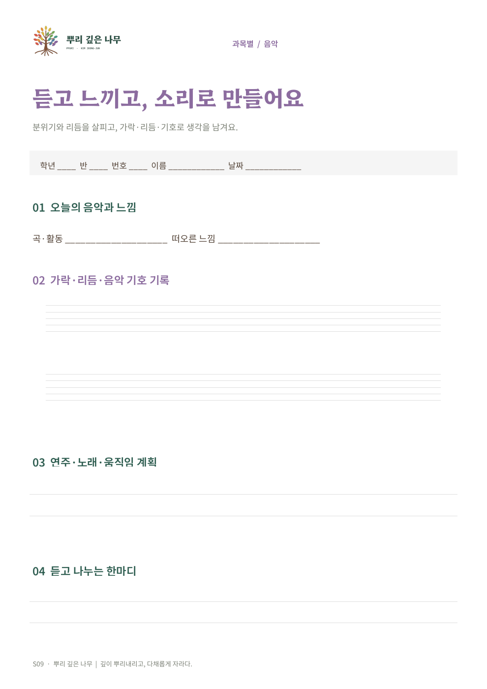
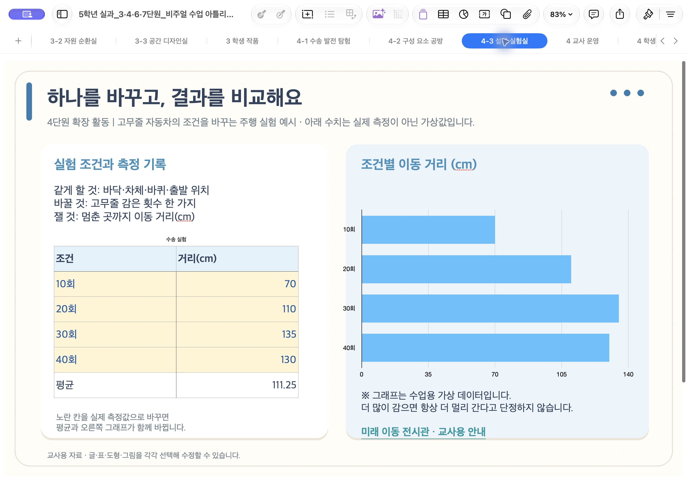

# 편집 가능한 수업 예시

GitHub 로그인 없이 보고 원본 ZIP을 받을 수 있습니다. 큰 파일은 릴리스에 두고 아래 미리보기만 소스에 포함했습니다. 실존 학생 결과물·교과서 페이지·타사 캐릭터는 없습니다. [이용 안내](USAGE.md) · [설치하기](../docs/INSTALL.md)

## Numbers·Keynote 수업 아틀리에

8개 Numbers 시트와 12장 Keynote, 네이티브 차트와 생성 일러스트. 글·표·그림을 앱에서 각각 편집할 수 있습니다.

[편집 원본 ZIP 받기](https://github.com/Kimmahone/apple-edu-mcp/releases/download/examples-2026-10-20/iwork-classroom-design-kit.zip) · 28.8 MiB

각 이미지 아래와 같은 원본 요소를 앱에서 직접 고칠 수 있습니다.

## Pages 학습지 템플릿 18종

유형별 8종·과목별 10종. 글·표·도형·브랜드 로고를 별도 요소로 편집합니다. 미리보기 PDF는 안내용이며 편집 원본은 .pages입니다.

[편집 원본 ZIP 받기](https://github.com/Kimmahone/apple-edu-mcp/releases/download/examples-2026-10-20/pages-worksheet-templates-18.zip) · 25.9 MiB

각 이미지 아래와 같은 원본 요소를 앱에서 직접 고칠 수 있습니다.

## 5학년 실과 교사용 수업 도화지

3·4·6·7단원 21개 시트와 네이티브 차트 4개. 공개 앱 링크·직접 바꿀 수 있는 용돈 표·학생 결과물을 나중에 넣는 빈 공간이 있습니다.

[편집 원본 ZIP 받기](https://github.com/Kimmahone/apple-edu-mcp/releases/download/examples-2026-10-20/practical-arts-teacher-canvas.zip) · 15.4 MiB

각 이미지 아래와 같은 원본 요소를 앱에서 직접 고칠 수 있습니다.

## 실제로 확인한 내용

Pages 18종은 글·표·도형·로고가 각각 별도 요소인 상태로 저장·재열기를 검사했습니다. Numbers·Keynote 디자인 키트는 8개 시트·12개 슬라이드와 각 네이티브 차트, 실과 자료는 21개 시트·4개 차트를 확인했습니다. 이 기록은 현재 Mac의 예시 검수이며 다른 기기에서의 동일한 글꼴·배치 보증은 아닙니다. 예시의 공개 앱 API 후처리와 화면 검수는 기본 MCP 도구 지원 범위와 구분합니다.

파일별 체크섬은 [공개 목록](catalog.json)에 있습니다. 원본을 보존하려면 다운로드한 예시를 먼저 복제해 사용하세요.
